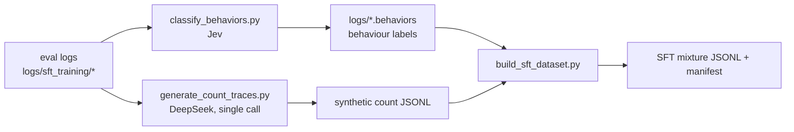

# SFT behaviour pipeline

This document describes the code that turns the four teacher evaluations into a
behaviour-labelled, behaviour-balanced SFT dataset:



| Tool | Purpose |
|---|---|
| `utils/behaviors.py` | shared labels, Jev prompt/state builders, answer parsing, metrics |
| `utils/jev_client.py` | minimal TypeSafe System One client (retries, usage, cost) |
| `utils/classify_behaviors.py` | label every record of an eval log with Jev |
| `utils/generate_count_traces.py` | generate `<count>` traces with DeepSeek (gold-conditioned, no tool simulation) |
| `utils/build_sft_dataset.py` | select, stratify and write the SFT mixture |

---

## 1. Behaviour labels

Every answer gets exactly one label from `utils/behaviors.py`:

| Label | Definition |
|---|---|
| `best` | The answer is correct. The model starts from the question entities/constraints and reaches the answer by retrieving and chaining external facts; the answer is supported by those facts and the trace uses them. |
| `acceptable` | The answer is correct. The model effectively knows or proposes it from parametric knowledge and then verifies/supports it with retrieved facts. |
| `bad` | The answer is correct, but the retrieved facts do not support it (wrong/irrelevant/insufficient facts; right answer from guessing/parametric knowledge). |
| `error` | The answer is wrong or missing, and the retrieved facts do not provide it. |

Two companion `noul` questions are asked in the same Jev request and stored next
to the label:

- `answer_supported_by_facts` — probability that the retrieved facts support the answer;
- `derived_from_facts` — probability that the trace derived the answer from the facts.

A wrong answer whose facts *do* support the answer is labelled `error` (per the
definition) and gets `diagnostic = "wrong_with_facts"`: that is the
"found the facts but mis-composed" failure mode.

Correctness is **verified** correctness (`strict` evaluator **or** semantic
`verify_answer`), not the raw strict flag, so date/alias misevaluations are not
misclassified as `error`.

---

## 2. Label a log with Jev

```bash
# pilot: 500 records, offline heuristic (no API key)
python utils/classify_behaviors.py logs/sft_training/mintaka_train_eval_qwen38_27b.out.3.gz \
    --limit 500 --mock --output /tmp/mintaka_pilot.behaviors

# full run
export TYPESAFE_API_KEY=...
python utils/classify_behaviors.py logs/sft_training/*.out* \
    --output-dir logs/behaviors --workers 8 \
    --report logs/behaviors/behavior_report.json
```

The input is the `utils/eval.py` JSONL log. The output has the **same format**
(header, records, `macro_*` summary) with a `behavior` object added, so it can be
used on test sets and by every existing reader:

```json
"behavior": {
  "label": "best",
  "confidence": 0.91,
  "probabilities": {"best": 0.91, "acceptable": 0.07, "bad": 0.01, "error": 0.01},
  "supported_probability": 0.96,
  "derived_probability": 0.88,
  "diagnostic": "best",
  "model": "jev-1.14.0",
  "usage": {"input_tokens": 1873, "output_tokens": 0}
}
```

The header gains `behavior_metadata`; the macro summary gains `behavior_counts`,
`behavior_errors` and `behavior_usage`. For chunked runs use
`--start N --limit M --append` (no summary is written in append mode).

### Jev request

`POST https://api.typesafe.ai/v1/systemone` with
`Authorization: Bearer $TYPESAFE_API_KEY`:

```json
{
  "model": "jev-1.14.0",
  "state": {
    "dataset": "mintaka",
    "question_type": "count",
    "question": "...",
    "answer_is_correct": true,
    "evaluator_correct": true,
    "reference_answer": ["8"],
    "final_answer": ["8"],
    "retrieved_facts": ["<France> <shares border with> <Belgium> ."],
    "model_trace": "... (head+tail, <= 8000 chars)"
  },
  "questions": {
    "behavior": {
      "type": "choice",
      "instructions": "Classify how the model produced its final answer...",
      "criteria": {"best": "...", "acceptable": "...", "bad": "...", "error": "..."}
    },
    "answer_supported_by_facts": {"type": "noul", "instructions": "..."},
    "derived_from_facts": {"type": "noul", "instructions": "..."}
  }
}
```

Pricing (jev-1.14.0): **$0.042 per 1M input tokens, output free**.

---

## 3. Generate count traces with DeepSeek

```bash
export DEEPSEEK_API_KEY=...
python utils/generate_count_traces.py \
    --input logs/sft_training/mintaka_train_eval_qwen38_27b.out.3.gz \
    --select teacher-wrong-or-no-count --n 1000 \
    --output logs/synthetic/count_traces.jsonl
```

The generator is intentionally simple:

1. send the real task prompt plus the question **and its gold answer** to the
   model (gold-conditioned);
2. take the single response and check, with a regex, that `<count>` was used and
   that the `<answer>` block parses;
3. save the trace.

There is no tool simulation and no external count lookup: the model writes the
count call itself and the data is fully synthetic. Samples whose answer does not
match the reference are dropped unless `--keep-incorrect` is passed.

Use `--continue` to resume a run: questions already present in `--output` are
skipped and the new records are appended (the file is rewritten with the
existing records plus a fresh summary line). A tqdm progress bar is shown unless
`--quiet` is passed.

Prompts: `--prompt` is a meta prompt
(`prompts/prompt_qwen36_synthetic_generator.yaml`) that **encapsulates the real
task prompt** (`--task-prompt`, default
`prompts/prompt_qwen36_angular2_nothink.yaml`) and asks the model to produce one
example from the **question and its correct answer**. The task prompt is also
what is stored in the output records, so the SFT context matches deployment.
Records are tagged `generator.gold_conditioned = true`.

Candidate selection: `--select all | teacher-wrong | teacher-no-count |
teacher-wrong-or-no-count` (default targets the behaviour gap).

Output: an eval-format JSONL with `synthetic: true`, `generator`, `verification`
(`count_called`, `answer_ok`), and `prompt`/`full_prediction` ready for
`utils/sft_train.py`.

---

## 3b. Backtracking traces (removed)

Synthetic backtracking generation is **not part of the pipeline**. The tool was
removed: templated/injected corrections can teach a ritualistic "explore → reject
→ resume" pattern and extra verbosity, and the behaviour is better left to
on-policy RL (GSPO) on a verifier than to imitation of synthetic detours. The
motivation and validation contract remain in `sft_synthetic_data_plan.md` §3.4
for reference; the SFT mixture does not include synthetic backtracking.

---

## 4. Build the SFT mixture

```bash
python utils/build_sft_dataset.py \
    --natural logs/behaviors/mintaka.behaviors \
              logs/behaviors/2wiki.behaviors \
              logs/behaviors/webqsp.behaviors \
              logs/behaviors/cwq.behaviors \
    --synthetic logs/synthetic/count_traces.jsonl \
    --output logs/sft_training_mix.jsonl \
    --two-wiki-cap 2000 --best-ratio 0.75 --min-acceptable 0.15
```

Selection rules:

1. **Positives**: `evaluation.correct == 1` (or `--verified`), `triples > 0`, not
   truncated.
2. **All non-2Wiki positives** are kept; 2Wiki is capped at `--two-wiki-cap`.
3. **Behaviour-aware caps**: when a cap applies (2Wiki, `--max-per-type`,
   `--max-per-dataset`), `best` and `acceptable` are sampled at
   `--best-ratio` (default 75/25), with `--min-acceptable` as a floor. The
   allocation is per question type, proportional to available data.
4. `bad` traces are dropped unless `--include-bad`; positives mislabelled
   `error` by Jev are dropped unless `--keep-error-labeled`.
5. **Synthetic count traces** are added as `best` (they are count-grounded and
   verified).
6. **Deduplicate by question**; synthetic wins over a duplicate natural trace.
7. Shuffle with `--seed` for reproducibility.

Use `--enforce-best-ratio` to globally downsample `acceptable` so the overall
best:acceptable ratio approaches 75/25. Without it, uncapped datasets keep all
their positives and the achieved ratio is reported in the manifest.

### Does 75/25 make sense?

Yes as a starting point, with two caveats:

- `best` is the behaviour we want to teach (ground the answer in retrieved
  facts), so a 3:1 bias is defensible; `acceptable` still teaches verification,
  which is useful for questions where parametric knowledge is legitimate.
- Do not let `acceptable` collapse: keep a floor (the default 15%) and apply the
  ratio **per question type**, not only globally, so weak types do not lose
  their verification traces. Run an ablation (75/25 vs 50/50 vs 90/10) and watch
  `bad` (correct-but-unsupported) and tool-use precision.

Synthetic count traces count as `best`, so they push the achieved ratio above
75/25; the manifest reports the actual value.

### Output

```json
{
  "_report": true,
  "params": {"two_wiki_cap": 2000, "best_ratio": 0.75, ...},
  "counts": {
    "total": 7180,
    "by_dataset": {"mintaka": 3446, "webqsp": 554, "cwq": 1180, "2wiki": 2000},
    "by_behavior": {"best": 5450, "acceptable": 730},
    "by_provenance": {"natural": 6180, "synthetic": 1000}
  }
}
{"question": "...", "prompt": "...", "full_prediction": "...", "triples": [...],
 "dataset": "mintaka", "behavior": "best", "provenance": "natural", ...}
```

The sample fields match `utils/filter_positive_training_samples.py` plus
`behavior`, `behavior_confidence`, `question_type`, `answer_shape`, `provenance`,
`source_log` and `synthetic`. `utils/sft_train.py` reads `prompt` and
`full_prediction`, so the file can be passed directly to it.

A manifest is written next to the output with all counts, skipped records and
parameters.

---

## 5. Cost

Measured judge inputs (300 records/dataset, trace capped at 8k chars) and the
official prices:

| Scope | Calls | DeepSeek Flash off-peak | DeepSeek peak | Jev 1.14 |
|---|---:|---:|---:|---:|
| Final mix (~7 180) | 7 180 | ~$1.9 | ~$3.8 | ~$0.53 |
| Full four-dataset pool | 51 319 | ~$11.9 | ~$23.8 | ~$3.32 |
| Correct answers only | 21 055 | ~$3.8 | ~$7.6 | ~$1.06 |

Synthetic count generation (measured: ~1 002 calls, ~1 840 input and 143 output
tokens per call, ~100 % acceptance): **~$0.3 off-peak / ~$0.6 peak** for 1 000
accepted traces.

Run a small pilot (`--n 50`, <$0.05) first to check the trace format before the
full run.

---

## 6. Offline testing

The count generator requires an API key; its CLI tests stub the chat client.
`utils/build_sft_dataset.py` is fully offline. The test suite covers the
deterministic pieces:

```bash
python -m unittest tests.test_behaviors tests.test_classify_behaviors \
    tests.test_generate_count_traces tests.test_build_sft_dataset
```

---

## 7. Caveats

- **Jev validation**: the four-way distinction is nuanced. Audit 200–500 records
  with DeepSeek (or humans) before trusting Jev at scale; `behavior.confidence`
  and the two `noul` probabilities are stored for filtering.
- **Gold count source** does not verify that the relation the model asked for is
  the intended one; every count is now gold-conditioned and the model writes the
  count itself, so check the generated relation in an audit sample.
- **Thinking mode** on DeepSeek multiplies output tokens (and cost). The
  generator sends `thinking: {"type": "disabled"}` by default (`--thinking omit`
  to drop the field).
- The classifier reads the trace, so very long traces are clipped (head+tail);
  the final answer and the retrieved facts are always included.

---

## 8. Proposed diagnostic: fact / tool utility

A follow-up analysis (not implemented yet) measures whether the retrieved facts
and counts were *necessary* to reach the answer: an LLM judge proposes a minimal
useful set and the trace's calls are compared with it (utility precision/recall,
wasted calls, calls per useful fact). It separates "correct but wasteful" from
"correct and grounded" and can feed a GSPO reward term. Full method and caveats:
`sft_synthetic_data_plan.md` §11 and `advanced_error_analysis_report.md`.
