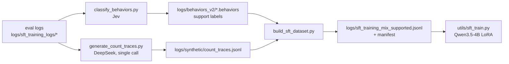

# SFT data pipeline

This document describes the code that turns the four teacher evaluations into a
support-labelled SFT dataset:



| Tool | Purpose |
|---|---|
| `utils/behaviors.py` | shared support label, Jev state/question builders, answer parsing, metrics |
| `utils/jev_client.py` | minimal TypeSafe System One client (retries, usage, cost) |
| `utils/classify_behaviors.py` | label every record as `supported` / `unsupported` with Jev |
| `utils/generate_count_traces.py` | generate `<count>` traces with DeepSeek (gold-conditioned, no tool simulation) |
| `utils/build_sft_dataset.py` | select, stratify and write the SFT mixture |

---

## 1. Support labels

The classifier answers one yes/no question per record, over the **question**, the
**model's answer**, and the **`triples` field of the evaluation log** (the decoded
generated triples written by `utils/eval.py`; no regex or trace parsing):

> Consider the question and these facts. Is the answer supported by these facts?
> Do not use additional knowledge to decide whether the answer is true or not.
> Limit to simply decide whether the answer is supported by the given facts or not.

| Label | Meaning |
|---|---|
| `supported` | The provided facts contain enough information to support the answer. |
| `unsupported` | The provided facts do not support the answer (the answer may still be true in reality). |

`unsupported` is the "correct but ungrounded / wrong evidence" signal used to
filter the natural pool; it is **not** a correctness judgement. Correctness is
still the verified evaluator label (`strict` **or** semantic `verify_answer`).

The log field is `triples`. There is no `generated_triples` key: `utils/eval.py`
writes `state.generated_triples` into `triples`, and that value is sent verbatim.

---

## 2. Label a log with Jev

```bash
# pilot: 500 records, offline heuristic (no API key)
python utils/classify_behaviors.py logs/sft_training_logs/mintaka_train_eval_qwen38_27b.out.3.gz \
    --limit 500 --mock --output /tmp/mintaka_pilot.behaviors

# full run (what produced logs/behaviors_v2/)
export TYPESAFE_API_KEY=...
python utils/classify_behaviors.py logs/sft_training_logs/*.out* \
    --output-dir logs/behaviors_v2 --workers 8 \
    --report logs/behaviors_v2/report.json
```

The input is the `utils/eval.py` JSONL log. The output has the **same format**
(header, records, `macro_*` summary) with a `behavior` object added, so it can be
used on test sets and by every existing reader:

```json
"behavior": {
  "label": "supported",
  "probability": 0.93,
  "confidence": 0.93,
  "probabilities": {"supported": 0.93, "unsupported": 0.07},
  "model": "jev-1.14.0",
  "usage": {"input_tokens": 1873, "output_tokens": 0}
}
```

`--support-threshold` (default 0.5) converts the probability into the label;
`confidence` is `max(probability, 1 − probability)` so `--min-confidence` filters
uncertain decisions. `--max-facts` (default 200) and `--max-fact-chars` (500)
bound the facts sent.

The header gains `behavior_metadata`; the macro summary gains `behavior_counts`,
`behavior_errors` and `behavior_usage`. For chunked runs use
`--start N --limit M --append` (no summary is written in append mode).

### Jev request

`POST https://api.typesafe.ai/v1/systemone` with
`Authorization: Bearer $TYPESAFE_API_KEY`:

```json
{
  "model": "jev-1.14.0",
  "state": {
    "question": "How many countries border France?",
    "answer": ["8"],
    "facts": [" <France> <shares border with> <Belgium> .", " ..."]
  },
  "questions": {
    "answer_supported": {
      "type": "noul",
      "instructions": "Consider the question and these facts. Is the answer supported by these facts? Do not use additional knowledge to decide whether the answer is true or not. Limit to simply decide whether the answer is supported by the given facts or not.",
      "criteria": {
        "true": "The provided facts contain enough information to support the answer.",
        "false": "The provided facts do not support the answer, even if the answer may be true in reality."
      }
    }
  }
}
```

Pricing (jev-1.14.0): **$0.042 per 1M input tokens, output free**.

---

## 3. Generate count traces with DeepSeek

```bash
export DEEPSEEK_API_KEY=...
python utils/generate_count_traces.py \
    --input logs/sft_training_logs/mintaka_train_eval_qwen38_27b.out.3.gz \
    --select teacher-wrong-or-no-count --n 1000 \
    --output logs/synthetic/count_traces.jsonl
```

The generator is intentionally simple:

1. send the real task prompt plus the question **and its gold answer** to the
   model (gold-conditioned);
2. take the single response and check, with a regex, that `<count>` was used and
   that the `<answer>` block parses;
3. save the trace.

There is no tool simulation and no external count lookup: the model writes the
count call itself and the data is fully synthetic. Samples whose answer does not
match the reference are dropped unless `--keep-incorrect` is passed.

Use `--continue` to resume a run: questions already present in `--output` are
skipped and the new records are appended (the file is rewritten with the
existing records plus a fresh summary line). A tqdm progress bar is shown unless
`--quiet` is passed.

Prompts: `--prompt` is a meta prompt
(`prompts/prompt_qwen36_synthetic_generator.yaml`) that **encapsulates the real
task prompt** (`--task-prompt`, default
`prompts/prompt_qwen36_angular2_nothink.yaml`) and asks the model to produce one
example from the **question and its correct answer**. The task prompt is also
what is stored in the output records, so the SFT context matches deployment.
Records are tagged `generator.gold_conditioned = true`.

Candidate selection: `--select all | teacher-wrong | teacher-no-count |
teacher-wrong-or-no-count` (default targets the behaviour gap).

Output: an eval-format JSONL with `synthetic: true`, `generator`, `verification`
(`count_called`, `answer_ok`), and `prompt`/`full_prediction` ready for
`utils/sft_train.py`.

---

## 3b. Backtracking traces (removed)

Synthetic backtracking generation is **not part of the pipeline**. The tool was
removed: templated/injected corrections can teach a ritualistic "explore → reject
→ resume" pattern and extra verbosity, and the behaviour is better left to
on-policy RL (GSPO) on a verifier than to imitation of synthetic detours. The
motivation and validation contract remain in `sft_synthetic_data_plan.md` §3.4
for reference; the SFT mixture does not include synthetic backtracking.

---

## 4. Build the SFT mixture

```bash
python utils/build_sft_dataset.py \
    --natural logs/behaviors_v2/*.behaviors \
    --synthetic logs/synthetic/count_traces.jsonl \
    --verified \
    --output logs/sft_training_mix_supported.jsonl \
    --two-wiki-cap 2000
```

`--include-bad` is **not** passed, so unsupported traces are dropped: the
mixture is supported-only. `--best-ratio`/`--min-acceptable` are unnecessary for
support-labelled logs (there is no `acceptable` class); they are kept only for
legacy logs.

Selection rules:

1. **Positives**: `evaluation.correct == 1` (or `--verified`), `triples > 0`, not
   truncated.
2. **All non-2Wiki positives** are kept; 2Wiki is capped at `--two-wiki-cap`.
3. **Support filter**: `unsupported` traces are dropped unless `--include-bad`.
   Positives mislabelled `error` in legacy logs are dropped unless
   `--keep-error-labeled`.
4. **Legacy `best`/`acceptable` logs**: when a cap applies, the 75/25 ratio and
   `--min-acceptable` are still honoured. Support-labelled logs have no
   `acceptable` class, so an applied cap keeps all `supported` traces and the
   manifest reports the ratio (100/0).
5. **Synthetic count traces** are added as `supported` (count-grounded and
   verified).
6. **Deduplicate by question**; synthetic wins over a duplicate natural trace.
7. Shuffle with `--seed` for reproducibility.

`--enforce-best-ratio` only affects legacy `acceptable` traces; it is a no-op
for support-labelled logs. Uncapped datasets keep all their supported positives.

### Why the 4-way split was dropped

The old `best`/`acceptable`/`bad`/`error` classification put 98.4% of the
verified positives in `best`, with almost no `acceptable` (0 in 2Wiki), so the
75/25 target was unattainable. The support question is the part that mattered
(keeping grounded answers, dropping unsupported ones), so the classifier now
returns a single `supported`/`unsupported` decision and the builder keeps
`supported` (dropping `unsupported` unless `--include-bad`).

`unsupported` traces are a natural DPO rejected pool (`utils/select_dpo_data.py`).

### Output

Real manifest for `logs/sft_training_mix_supported.jsonl` (6,966 samples):

```json
{
  "_report": true,
  "params": {"two_wiki_cap": 2000, "include_bad": false, "verified": true, "seed": 42, ...},
  "skipped": {"not_positive": 30346},
  "duplicates": {"natural": 57},
  "counts": {
    "total": 6966,
    "by_dataset": {"mintaka": 3304, "2wiki": 2000, "cwq": 1114, "webqsp": 548},
    "by_provenance": {"natural": 5966, "synthetic": 1000},
    "by_behavior": {"supported": 6966},
    "by_type": {"count": 1140, "generic": 1086, "compositional": 792,
                "comparison": 710, "comparative": 623, "single-entity": 590,
                "multi-entity": 524, "bridge_comparison": 465, "yesno": 367,
                "multihop": 233, "intersection": 203, "ordinal": 120,
                "difference": 44, "superlative": 36, "inference": 33},
    "by_shape": {"entity": 3307, "yes/no": 1503, "numeric": 1216,
                 "date": 685, "list": 255}
  }
}
{"question": "...", "prompt": "...", "full_prediction": "...", "triples": [...],
 "dataset": "mintaka", "behavior": "supported", "provenance": "natural", ...}
```

The sample fields match `utils/filter_positive_training_samples.py` plus
`behavior`, `behavior_confidence`, `question_type`, `answer_shape`, `provenance`,
`source_log` and `synthetic`. `utils/sft_train.py` reads `prompt` and
`full_prediction`, so the file can be passed directly to it.

A manifest is written next to the output with all counts, skipped records and
parameters.

### Training

The mixture is the direct input of `utils/sft_train.py`. Config:
`configs/sft_config_supported_mix.json` (Qwen3.5-4B, LoRA r8/α16, bs 2 ×
grad-accum 8, 2 epochs, lr 2e-5, `max_length` 2048, `val_split` 0.1, wandb).
SLURM script: `hpc/sft_train_supported_mix.sh` (2 GPUs, 24 h).

Shuffling and splitting:

1. `build_sft_dataset.py` shuffles the final mixture with `--seed` (default 42)
   before writing, so the file order is already randomized.
2. `sft_train.py` then makes a **stratified** train/val split by
   `(dataset, complexityType)` with `--val-split` (0.1 here), not a plain
   random split.
3. HuggingFace `Trainer` re-shuffles the training set every epoch
   (`RandomSampler`), so epoch order differs.

---

## 5. Cost

Measured judge inputs for the earlier trace-based classifier (300
records/dataset, trace capped at 8k chars). The support classifier sends only the
question, the answer and the `triples` field (no trace), so these are an **upper
bound**; measure the support run with a pilot.

| Scope | Calls | DeepSeek Flash off-peak | DeepSeek peak | Jev 1.14 |
|---|---:|---:|---:|---:|
| Final mix (~7 180) | 7 180 | ~$1.9 | ~$3.8 | ~$0.53 |
| Full four-dataset pool | 51 319 | ~$11.9 | ~$23.8 | ~$3.32 |
| Correct answers only | 21 055 | ~$3.8 | ~$7.6 | ~$1.06 |

Synthetic count generation (measured: ~1 002 calls, ~1 840 input and 143 output
tokens per call, ~100 % acceptance): **~$0.3 off-peak / ~$0.6 peak** for 1 000
accepted traces.

Run a small pilot (`--n 50`, <$0.05) first to check the trace format before the
full run.

### Measured Jev cost (v2, support classifier)

The `usage` block in `logs/behaviors_v2/report.json` is **cumulative per file**
(known reporting bug); the true per-file cost is the difference between
consecutive rows. Measured on the full pool:

| Dataset | Records | Supported | Jev cost |
|---|---:|---:|---:|
| CWQ | 9,360 | 2,992 | $0.627 |
| Mintaka | 14,000 | 5,226 | $0.877 |
| 2Wiki | 25,133 | 20,032 | $0.658 |
| WebQSP | 2,826 | 1,480 | $0.158 |
| **Total** | **51,319** | **29,730** | **$2.319** |

Filtering the verified positives only (20,973 records, 20,418 supported) would
cost roughly **$0.6–0.8**; the full-pool figure above is what the actual run
cost. Cost is ~$0.045 per 1k records with the `triples`-only state.

---

## 6. Offline testing

The count generator requires an API key; its CLI tests stub the chat client.
`utils/build_sft_dataset.py` is fully offline. The test suite covers the
deterministic pieces:

```bash
python -m unittest tests.test_behaviors tests.test_classify_behaviors \
    tests.test_generate_count_traces tests.test_build_sft_dataset
```

---

## 7. Caveats

- **Jev validation**: the support decision is a single binary and much more
  reliable than the old four-way split, but still audit 200–500 records before
  trusting it at scale; `behavior.confidence` and the two `noul` probabilities
  are stored for filtering. On the verified positives it labels 97.4% supported
  (20,418/20,973); the 555 `unsupported` are mostly closed-world "No", derived
  counts and ISO-date vs `D-Mon-YY` formatting, not real ungrounded answers.
- **`mask_triples` is currently a no-op.** `sft_train.py:locate_fact_ranges()`
  looks for `"Fact:"` while the traces use `<fact> … </fact>`, so no range is
  found. The supported-mix config sets `mask_triples: false` explicitly to avoid
  the misleading "Masked 0 Fact: lines" message. A real fix would be
  `re.finditer(r"<fact>.*?</fact>", text, re.DOTALL)`.
- **Gold count source** does not verify that the relation the model asked for is
  the intended one; every count is now gold-conditioned and the model writes the
  count itself, so check the generated relation in an audit sample.
- **Thinking mode** on DeepSeek multiplies output tokens (and cost). The
  generator sends `thinking: {"type": "disabled"}` by default (`--thinking omit`
  to drop the field).
- The classifier reads the trace, so very long traces are clipped (head+tail);
  the final answer and the retrieved facts are always included.

---

## 8. Proposed diagnostic: fact / tool utility

A follow-up analysis (not implemented yet) measures whether the retrieved facts
and counts were *necessary* to reach the answer: an LLM judge proposes a minimal
useful set and the trace's calls are compared with it (utility precision/recall,
wasted calls, calls per useful fact). It separates "correct but wasteful" from
"correct and grounded" and can feed a GSPO reward term. Full method and caveats:
`sft_synthetic_data_plan.md` §11 and `advanced_error_analysis_report.md`.
